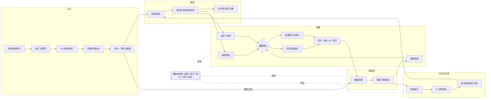
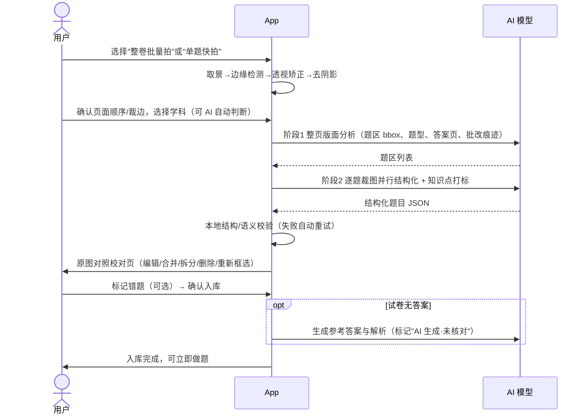
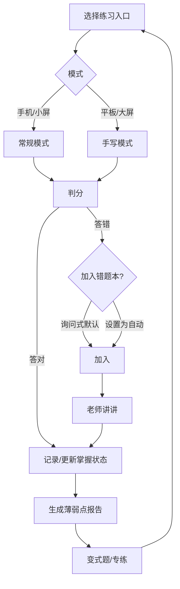
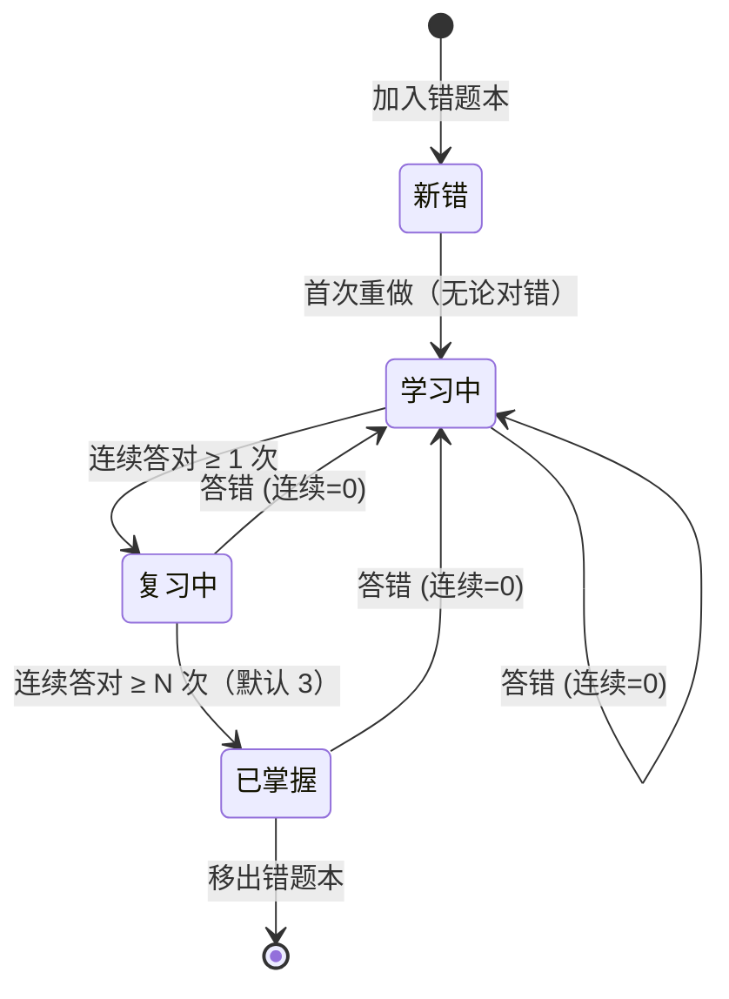

# InoU（暂定名）· 产品需求文档 PRD

| 项 | 内容 |
|---|---|
| 版本 | v0.1（Demo 阶段需求基线） |
| 日期 | 2026-11-20 |
| 状态 | 评审稿（基于 24 项需求访谈决策整理，见 [第 12 章](#12-决策记录)） |
| 配套文档 | [开发文档](./02-开发文档.md) · [低保真线框图](./03-低保真线框图.md) · [题型 JSON 示例与 AI Prompt 库](./04-题型JSON示例与AI-Prompt模板库.md) · [知识点树种子](./05-知识点树种子.md) |

---

## 1. 产品概述

### 1.1 一句话定位
**拍下试卷/练习册 → AI 自动数字化成个人题库 → 在手机或平板上"像做题 App 一样"或"像做纸质卷子一样"重做 → 错题自动沉淀、分析薄弱点、生成针对性练习，并有可爱的看板娘老师全程讲解答疑。**

### 1.2 背景与痛点
| 痛点 | 现状 | 本产品的解法 |
|---|---|---|
| 纸质错题整理费时 | 抄题、剪贴、重画图，家长/学生耗时巨大 | 拍照即录入，AI 结构化，校对后入库 |
| 做完就忘 | 错题无复习闭环 | 错题本 + 掌握状态 + 针对性变式题 |
| 不知道弱在哪 | 只能凭感觉 | 知识点树聚合统计 + AI 诊断报告 |
| 没人讲解 | 家长不会讲/没时间 | 看板娘老师分步讲解、苏格拉底式提示 |
| 电子做题不像考试 | 小屏做题与纸质手感差距大 | 平板"纸质手写模式"，保留书写习惯 |

### 1.3 目标用户
- **主要用户**：小学高年级～高中学生（约 9–18 岁），学校试卷/练习册为主，覆盖语文、数学、英语、物理、化学、生物等。
- **辅助用户**：家长（与孩子共用设备时协助录题、核对 AI 答案）。首版**不设独立家长角色**。
- **设备**：Android 手机与平板（优先），iOS/iPadOS 代码同源保持兼容。

### 1.4 产品目标（Demo 阶段）
1. 端到端跑通核心闭环：**拍照录入 → 题库 → 练习 → 错题本 → 薄弱点报告 → AI 生成练习 → 再练习**。
2. 两种做题模式均可用：**常规数字化模式**（手机友好）与**手写纸质模式**（平板友好）。
3. 看板娘老师与核心 AI 能力以**自主 Agent 运行时**驱动（具备思考-调用工具-验证-记忆循环，而非静态单轮问答），可主动检索题库/错题/薄弱点、验算并派发生成任务。
4. 一套代码自适应手机与平板。
5. 数据全部**本地存储**，AI 能力通过**用户自备 API Key（BYOK）**直连，无需自建后端；首版同时支持 **Google Gemini 原生协议** 与 **OpenAI 兼容请求格式**（可接 OpenAI、通义千问 VL、智谱 GLM-4V、豆包、One-API/New-API 等兼容服务）。

### 1.5 非目标（Demo 阶段明确不做）
- 账号体系、云端同步、云端题库（后续通过网盘云备份实现，见 §9.2）。
- 公共题库/题库共享（架构预留扩展点）。
- 独立家长端、班级/老师端。
- 口语跟读题 `speech`（暂缓）。
- 间隔重复（SRS）每日推送、打卡/成就体系、答题耗时统计面板、语音输入（已记录，见 §9.3 暂缓清单）。
- 应用商店上架级别的合规与商业化（付费、广告）。

---

## 2. 名词解释

| 名词 | 含义 |
|---|---|
| 来源卷/册（SourceDoc） | 一份试卷或一本练习册，含若干页原始照片，是题目的归属容器 |
| 题目（Question） | 结构化数字题，含题干、选项/空位、答案、解析、知识点等 |
| 组合题（group） | 共享材料 + 多个小题（阅读理解、完形填空、材料题等），单层 |
| 错题本（WrongBook） | 用户收藏/自动沉淀的错题集合，带掌握状态与错因 |
| 知识点树 | 学段→学科→模块→主题→叶子知识点，内置、可更新 |
| 常规模式 | 数字化卡片式做题，适合小屏 |
| 手写模式 | A4/B5 纸质试卷版式，笔迹层叠加，适合平板与触控笔 |
| 看板娘 | 可爱的 AI 老师角色（静态立绘 + 表情差分 + 气泡对话） |
| BYOK | Bring Your Own Key，用户自备大模型 API Key |

---

## 3. 功能全景

---

## 4. 核心用户流程

### 4.1 首次使用
1. 欢迎页 → 创建学习档案（昵称、学段、年级、主要学科）→ 隐私与数据说明（图片将发送至所配置的 AI 服务）→ 配置 AI 服务（选择协议：Gemini 原生 / OpenAI 兼容格式，填写 API Key、可选 Base URL 与模型名；可跳过，仅浏览，使用 AI 功能时再次引导）→ 看板娘自我介绍 → 首页。

### 4.2 拍照录题

### 4.3 练习与错题闭环

---

## 5. 功能需求

> 优先级：**P0** Demo 必须；**P1** Demo 期内尽量完成；**P2** 后续版本。

### F1 学习档案与设置
| ID | 需求 | 优先级 | 验收要点 |
|---|---|---|---|
| F1.1 | 创建/切换/删除本地学习档案；各档案题库、错题本、报告、看板娘对话完全隔离 | P0 | 切换档案后数据互不可见；删除需二次确认并清除其全部本地数据 |
| F1.2 | 档案字段：昵称、头像、学段、年级、主修学科 | P0 | 影响默认学科筛选与看板娘语气 |
| F1.3 | 家长锁：可选 PIN，保护"设置 / API Key / 数据导出 / 档案删除" | P1 | 未输入 PIN 无法进入受保护页面 |
| F1.4 | AI 配置：支持保存多套服务配置并切换；每套含协议类型（**Gemini 原生 / OpenAI 兼容格式**）、Base URL（含常见兼容厂商预设与自定义）、API Key（本地安全存储）、模型名（支持按 `fast/balanced/strong` 档位配置或单模型兜底）、连通性与识图能力测试、用量统计（调用次数与 token 估算） | P0 | Key 不出现在日志与导出包明文中；测试按钮给出明确错误原因；OpenAI 兼容端点可正确校验识图/JSON 支持 |
| F1.5 | 偏好：做题默认模式、错题收录方式（询问/自动）、"已掌握"连续答对次数 N（默认 3）、看板娘开关与 TTS 开关 | P0 | 设置即时生效 |

### F2 拍照录入与数字化
| ID | 需求 | 优先级 | 验收要点 |
|---|---|---|---|
| F2.1 | **整卷/整页批量拍**：多张连续拍摄/相册多选，支持调整页序、删除页 | P0 | 单次支持 ≥ 20 页 |
| F2.2 | **单题快拍/手动框选**：只拍/框选一道题（常用于只录错题） | P0 | 框选后 ≤ 1 次点击提交识别 |
| F2.3 | 图像预处理：文档边缘自动检测、透视矫正、去阴影/增强、旋转 | P0 | 倾斜 ≤ 30° 的纸面可正确矫正；失败可手动调整四角 |
| F2.4 | AI 版面分析：返回每道题区域、题型猜测、跨页题标记、答案/解析页识别 | P0 | 评测集上题目切分准确率目标 ≥ 90%（见 §7.5） |
| F2.5 | AI 结构化：题干、选项、空位、公式（LaTeX）、表格、配图自动裁剪成题目图片 | P0 | 公式以 LaTeX 渲染；配图保留清晰度并与题目关联 |
| F2.6 | 学科/年级自动判断，可人工修改 | P1 | 判断错误时一键更正，更正后对其余题批量生效 |
| F2.7 | **原图对照校对页**：左（平板）/上（手机）原图高亮区域，右/下为可编辑结构化题目；支持编辑题干/选项/答案、**合并/拆分/删除题目**、**重新框选区域并重识别**、修改题型、调整知识点；**确认后才入库** | P0 | 未确认的题不进入题库；离开保存为草稿，可恢复 |
| F2.8 | 试卷自带答案/解析页识别并按题号匹配；无答案时由 AI 解题生成"参考答案与解析"并标记**"AI 生成·未核对"** | P0 | 匹配结果可在校对页逐题查看；数学类题 AI 二次独立求解，不一致标红提示 |
| F2.9 | **批改痕迹识别**：识别学生原作答与老师红笔对错标记，用于"标记为错题"建议，**不进入题面**；原作答保存为错题的"我当时的答案" | P1 | 识别到❌/扣分的题目默认勾选"标记为错题"，用户可改 |
| F2.10 | 校对页"标记为错题"：卷面上已做错的题可直接入错题本 | P0 | 入库后错题本即时可见 |
| F2.11 | 重复题检测：入库时基于文本相似度提示"疑似重复"，可选择合并/保留/跳过 | P1 | 相同题重复拍摄时命中率目标 ≥ 85% |
| F2.12 | 识别失败/低置信度题目标记并进入"待人工处理"队列 | P0 | 低置信度项在校对页有显著标识 |
| F2.13 | 原始照片永久保留于来源卷（可在设置中选择压缩策略） | P0 | 题目可跳转查看原始整页 |

### F3 题库
| ID | 需求 | 优先级 | 验收要点 |
|---|---|---|---|
| F3.1 | 三层结构：**来源卷/册 → 题目**；来源卷含类型（试卷/练习册/其他）、学科、年级、标题、原始照片 | P0 | 删除来源卷时可选择"连带删除题目"或"保留题目" |
| F3.2 | 题目属性：学科、年级、题型、难度、知识点（1~3 个叶子）、标签、来源（拍照/AI 变式/AI 专练/手动）、原题号、答案来源（卷面/AI/手动）、是否已核对 | P0 | 可批量编辑 |
| F3.3 | 筛选与搜索：来源卷、学科、知识点（树选择）、题型、难度、标签、来源、是否错题、关键字全文搜索 | P0 | 万级题目下筛选响应 < 300 ms |
| F3.4 | 文件夹与自定义标签 | P1 | 题目可属多个标签、一个文件夹 |
| F3.5 | 手动新建/编辑题目（结构化编辑器：选题型→填题干/选项/答案） | P1 | 覆盖所有已支持题型的编辑 |
| F3.6 | 题目详情：题面、答案/解析（默认折叠）、原图定位、做题历史、错题状态、看板娘入口 | P0 | — |
| F3.7 | 软删除与回收站（30 天） | P1 | 误删可恢复 |

### F4 常规数字化做题模式（适合小屏）
| ID | 需求 | 优先级 | 验收要点 |
|---|---|---|---|
| F4.1 | 每种题型均提供**触控友好**的数字化作答组件（见 §6 题型表） | P0 | 单手拇指可完成选择、拖拽、连线 |
| F4.2 | 一屏一题的卡片流，顶部进度，底部"上一题/下一题/提交"；支持题号面板跳转与标记"存疑" | P0 | — |
| F4.3 | 组合题：材料区可折叠/吸顶，小题横向或纵向切换；手机上材料与小题上下分栏可拖拽调整比例 | P0 | 阅读材料长文本不挤压作答区 |
| F4.4 | 公式、图、表在小屏正常显示，图片可双击放大 | P0 | — |
| F4.5 | 数学/理化的"计算题/解答题"提供**分步输入**（每步一行 + 数学键盘 + 拍照传答案） | P0 | 键盘覆盖分数、根号、上下标、常用符号 |
| F4.6 | 草稿纸：每题可打开草稿浮层（简易手写/文字） | P1 | 草稿不参与判分，随题目保存可回看 |
| F4.7 | 作答中断恢复（切后台、杀进程后恢复） | P0 | 恢复后保留所有作答与计时 |

### F5 手写纸质模式（适合大屏平板）
| ID | 需求 | 优先级 | 验收要点 |
|---|---|---|---|
| F5.1 | 将题目**重新排版为纸质试卷版式**：A4/B5 分页，页眉（姓名/日期/卷名）、大题分区、题号、分值；题干由结构化数据渲染，非原始照片 | P0 | 排版稳定，公式/图/表不溢出，跨页合理分页 |
| F5.2 | 每题下方/旁边预留**作答区域**（可由用户拖拽调整高度），填空题在下划线/括号处书写，选择题可直接圈选/打勾 | P0 | 书写区尺寸适合书写，不遮挡题干 |
| F5.3 | 全页透明笔迹层：可在题面上圈画、批注 | P0 | 笔迹与题面坐标稳定，缩放平移不错位 |
| F5.4 | 书写工具：笔（粗细/颜色）、荧光笔、橡皮（笔画/局部）、撤销/重做、套索选择移动、直尺（P2）、草稿区侧栏 | P0（笔/橡皮/撤销/草稿区），P1（荧光笔/套索） | 笔迹延迟 < 30 ms（目标设备） |
| F5.5 | 触控笔支持：压感、倾斜、侧键橡皮；**手掌拒触**（检测到笔时忽略手指书写，双指缩放/平移页面） | P0 | 手掌搁置不产生笔迹 |
| F5.6 | 手写模式下的选择/判断题可点击选项或在括号手写；系统以"点选"为准，手写填写则交 AI 识别 | P0 | — |
| F5.7 | 提交后按题切分笔迹，交由判分链路（见 F6）；原笔迹永久保存，可回看批改 | P0 | 回看时能看到笔迹+判分标注叠加 |
| F5.8 | 笔迹数据为**矢量**存储（非位图），支持导出为 PDF/图片 | P1（导出） | — |
| F5.9 | 在大屏手机上也可开启手写模式（体验提示"推荐平板"） | P1 | — |
| F5.10 | "圈选求讲解"：在手写页圈选一块区域，把圈出的内容连同题目发给看板娘提问 | P1 | 圈选后弹出看板娘气泡并带圈选缩略图 |

### F6 判分
| ID | 需求 | 优先级 | 验收要点 |
|---|---|---|---|
| F6.1 | **客观题本地自动判分**：选择/判断、填空（含可接受答案列表、忽略大小写/空白、数值等价如 0.5 = 1/2）、排序、连线、分类、看图标注点选 | P0 | 本地判分，零网络，< 50 ms |
| F6.2 | **主观/手写题 AI 判分**：多模态模型看手写图 + 题目 + 标准答案/解析/评分点，输出判定（对/错/部分对/无法识别）、得分、识别文本、分步点评 | P0 | 返回结构化 JSON；AI 失败可重试或转自评 |
| F6.3 | **用户一键修改判定**（对/错/部分对）与得分；AI 判定与用户最终判定均留痕 | P0 | 修改后以用户判定为准，并计入掌握度 |
| F6.4 | **对照答案自评**模式作为兜底（无 Key/离线/AI 失败）：展示标准答案与解析，用户点"对/错/部分对" | P0 | 离线可用 |
| F6.5 | 判分时机：整卷模拟与自定义组卷默认**交卷后统一判分**；错题重做与单题练习默认**逐题即时反馈**，均可在设置中切换 | P0 | — |
| F6.6 | 判分结果页：总分/正确率/每题对错、AI 点评入口、错题一键入本、"让老师讲讲" | P0 | — |
| F6.7 | 判分前提示 AI 答案"未核对"的题目，其判定结果标注"依据 AI 参考答案" | P0 | 避免用户误信 |

### F7 错题本
| ID | 需求 | 优先级 | 验收要点 |
|---|---|---|---|
| F7.1 | **三种入口**：①拍照校对页标记；②练习答错后提示加入（默认询问式，可设为自动）；③题库任意题手动收藏 | P0 | 同一题只会存在一条错题记录，重复加入累计错误次数 |
| F7.2 | 错题字段：错因标签（概念不清/粗心/计算错误/审题错误/方法不会/书写不规范/其他，可多选，可由 AI 建议）、掌握状态（新错/学习中/复习中/已掌握）、错误次数、"我当时的答案"、笔记 | P0 | — |
| F7.3 | **掌握规则**：连续答对 N 次（默认 3，可配）→ 自动标记"已掌握"；再次答错 → 回到"学习中"并清零连续次数 | P0 | 规则透明，在错题详情可见 |
| F7.4 | 错题本筛选/排序：学科、知识点、错因、掌握状态、时间、错误次数 | P0 | — |
| F7.5 | 错题本内一键"错题重做"（选择范围/数量/是否仅未掌握） | P0 | 进入练习流程 |
| F7.6 | 错题批量操作：移出错题本、批量改错因/标签、导出为 PDF 打印版（P2） | P1 | — |

### F8 薄弱点分析与报告
| ID | 需求 | 优先级 | 验收要点 |
|---|---|---|---|
| F8.1 | **本地统计看板**（实时、零成本）：按知识点树聚合错题数、错误率、错因分布、掌握趋势（近 7/30/90 天）、学科雷达图、TOP 薄弱知识点排行 | P0 | 点击知识点可下钻到错题列表 |
| F8.2 | **AI 诊断报告**（用户点击"生成报告"触发）：由诊断 Agent 自主查询本地统计快照、拉取代表性错题样本与错因分布，输出薄弱点排序、原因分析、学习建议、本周/两周计划 | P0 | Markdown 报告 + 结构化摘要；生成时展示步骤进度；可取消 |
| F8.3 | 报告快照存入历史；支持与上一次报告对比（改善/退步知识点） | P1 | — |
| F8.4 | 报告内每个薄弱点提供"一键专练"与"看错题"按钮 | P0 | 与 F9 打通 |
| F8.5 | 样本不足提示：错题少于阈值（默认 5）时提示"数据较少，仅供参考" | P0 | — |
| F8.6 | 报告可导出为图片/PDF 分享（P2） | P2 | — |

### F9 AI 生成练习题
| ID | 需求 | 优先级 | 验收要点 |
|---|---|---|---|
| F9.1 | **变式题**：基于某道错题，生成同知识点、同题型、换数据/换情境的 1~5 道题 | P0 | 题目符合题库结构；与原题不重复 |
| F9.2 | **薄弱点专练**：基于报告/知识点选择，生成一组题；题型与难度梯度（基础→提高→拓展）可配，数量 5~20 | P0 | — |
| F9.3 | 生成质量闭环：出题 Agent 调用本地查重与提交工具（内置结构/语义校验，不通过直接向 Agent 返回错误定位令其自修）→ 委派独立验算子 Agent 核对终答案 → 不一致者丢弃或重生成 → 入库 | P0 | 入库题目 100% 通过本地校验 |
| F9.4 | 入库标记来源"AI 生成"，归入对应"AI 练习"来源册；用户可一键删除/修改/收藏 | P0 | — |
| F9.5 | 生成任务后台执行，可离开页面，完成后通知；失败可重试 | P1 | — |

### F10 看板娘老师
| ID | 需求 | 优先级 | 验收要点 |
|---|---|---|---|
| F10.1 | **角色呈现**：静态立绘 + 多表情差分（开心/思考/鼓励/惊讶/认真/无奈/庆祝…）+ 轻量动画（眨眼、呼吸、弹跳）+ 文字气泡；首页、做题页（可收起悬浮）、错题详情均可呼出 | P0 | 动画帧率稳定，低端设备可关闭动画 |
| F10.2 | **错题讲解**：在错题/判分结果页点击"老师讲讲"，看板娘 Agent 自主读取题目/作答/错题历史（可选调用计算沙盒验算），**流式**分步讲解并自动选择表情 | P0 | 首字出现 < 3 s（网络正常）；展示工具调用状态 |
| F10.3 | **针对当前题的追问**对话，每题独立持久化 Agent 会话状态；长对话自动摘要压缩并支持按需检索早期细节 | P0 | 重新打开该题可延续对话 |
| F10.4 | **分级提示（苏格拉底式）**：练习中老师不直接给答案，依次给出"思路提示 → 关键步骤 → 完整答案"，每级需用户主动请求，L1/L2 阶段在 Agent Hook 物理拦截读答案工具，使用提示次数计入记录 | P0 | L1/L2 物理无法读取标准答案且不泄露更深一级内容 |
| F10.5 | **通用问答**：全局悬浮入口，看板娘 Agent 可主动检索用户个人题库、错题统计与薄弱知识点解答学习问题 | P0 | — |
| F10.6 | **临时拍照/截图提问**（不入库的临时问题） | P0 | 支持一次最多 3 张图 |
| F10.7 | **手写模式"圈选求讲解"** | P1 | 见 F5.10 |
| F10.8 | **情感陪伴**：登录欢迎、练习鼓励、完成练习的庆祝反馈卡通表情；"休息提醒"（连续学习超过阈值） | P1 | 不打扰：可全局静音/关闭 |
| F10.9 | 可选 **TTS 朗读**（系统 TTS）；默认关闭 | P1 | 公式与英文单词朗读合理 |
| F10.10 | **角色包机制**：立绘/表情/提示词/语气策略可配置，支持更换角色；默认提供一套角色设定与占位立绘（见开发文档 §10） | P1 | 切换角色包不改代码 |
| F10.11 | 语气分学段：小学更童趣、初中鼓励为主、高中简洁专业；永不嘲讽、不直接评价孩子"笨" | P0 | 提示词安全约束已落地 |

### F11 自适应与界面
| ID | 需求 | 优先级 | 验收要点 |
|---|---|---|---|
| F11.1 | 手机竖屏、手机横屏、平板竖/横屏、折叠屏均能正常使用，按窗口宽度断点自适应（Compact / Medium / Expanded） | P0 | 无溢出、无点击目标过小 |
| F11.2 | 手机：底部导航；平板：侧边导航栏 + 主从双栏（列表-详情） | P0 | — |
| F11.3 | 做题模式推荐：Expanded 宽度且检测到触控笔 → 推荐手写模式；用户可手动切换 | P0 | — |
| F11.4 | 浅色/深色主题；字体缩放 0.85–1.5 | P1 | — |
| F11.5 | 无障碍：触控目标 ≥ 48dp，语义标签，色彩对比度 AA | P1 | — |

### F12 数据管理
| ID | 需求 | 优先级 | 验收要点 |
|---|---|---|---|
| F12.1 | 完全本地存储（SQLite + 本地文件），离线可用（除 AI 功能） | P0 | 断网可浏览题库、做题、自评 |
| F12.2 | **导出/导入备份包**（`.inou` 压缩包：数据库 + 图片 + 笔迹 + 元数据，不含 API Key）；导入支持"合并/覆盖" | P0 | 备份可在另一台设备恢复，数据一致 |
| F12.3 | 云备份适配（网盘：WebDAV / 阿里云盘 / 百度网盘 / Google Drive / 系统分享等），通过 `BackupProvider` 接口扩展 | P2 | Demo 之后实现 |
| F12.4 | 存储空间管理：占用统计、清理缓存、原图压缩 | P1 | — |

---

## 6. 题型体系

在 **res-hub 题库协议**（choice/fill/match/classify/response/speech/group，`spatial` 暂缓）基础上**复刻并扩展**。保留其核心设计：*题面与答案分离、选项/空位用稳定 id 引用、kind 表结构 / presentation.interaction 表交互、group 仅单层、判分配置独立*。详细协议见开发文档 §5。

| kind | 名称 | 来源 | 常规模式交互 | 手写模式交互 | 默认判分 |
|---|---|---|---|---|---|
| `choice` | 选择题（单/多选，**含判断题** `layout: truefalse`） | 复刻 | 点选卡片/列表 | 点选或在括号内手写字母 | 本地精确 |
| `fill` | 填空与排序（`input`/`pick`/`sequence`） | 复刻 | 键盘输入/选词/拖拽排序 | 在下划线/括号处手写 | 本地精确（手写→AI 识别后精确） |
| `match` | 连线匹配 | 复刻 | 点击配对/拖线 | 手写画线 | 本地精确（手写连线→AI 视觉判定） |
| `classify` | 分类题 | 复刻 | 拖放入类别 | 抄写序号/编号 | 本地精确 |
| `response` | 开放作答（简答/作文/翻译/解释） | 复刻，增加评分点与参考范文 | 文本框/拍照上传 | 页面区域手写 | **AI 判分 + 自评** |
| `group` | 组合题（阅读理解/完形/材料/听力文本题） | 复刻 | 材料吸顶 + 小题切换 | 材料与小题连续排版 | 聚合 |
| `solve` | **解答/分步计算证明题** | **新增** | 分步输入（每步一行 + 数学键盘） | 整页手写演算 | **AI 按步骤/评分点判分** |
| `draw` | **作图题**（几何作图、函数图象、电路图、受力分析…） | **新增** | 简易绘图画布（点/线/圆/标注）；小屏提示"建议用手写模式" | 手写画布 + 底图/坐标系/网格 | **AI 视觉判分 + 自评** |
| `spatial` | **看图/图形标注题**（在图上点选或标注区域，如地图、器官图、实验装置图） | **新增**（res-hub 暂缓项） | 点选/拖标签到热区 | 手写圈点/箭头 | 本地：点是否落入热区；标签拖拽精确匹配 |
| `write` | **书写题**（语文默写、拼音、笔顺、生字抄写、英语单词/句子抄写） | **新增** | 键盘输入/拼音输入（笔顺动画仅展示） | 田字格/拼音四线格手写 | **AI 识别 + 逐字对比**；笔顺为自评 |
| ~~`speech`~~ | 口语跟读 | 暂缓 | — | — | 后续 |

**判断题**归入 `choice`（两个选项 √/×），**解答/作文**分别归入 `solve`/`response`。内容组件（ContentBlock）在 res-hub 的 text/richText/image/audio/video/passage/slot 基础上新增 **`math`（LaTeX）、`table`、`figure`（题图，含裁剪来源）**；`audio/video` 首版仅作为占位（听力题可导入文本材料，音频由用户另行补充，P2）。

> 与 res-hub 的**简化点**：本 App 为个人单机题库，因此**去掉**其四个独立内容库与 `resourceRefs/refId` 间接引用及引用保护机制，图片直接以本地 `assetId` 引用；去掉 schema 说明书入库机制（以代码内置 + 提示词库替代）。**保留**其"题面/答案分离、稳定 id、严格校验、AI 与人工共用同一结构化协议"的理念。

---

## 7. 关键业务规则

### 7.1 答案来源与可信度
| 答案来源 `answerSource` | 含义 | UI 标识 |
|---|---|---|
| `paper` | 来自试卷自带答案页 | 绿色"卷面答案" |
| `ai` | AI 解题生成，未核对 | 橙色"AI 生成·未核对" |
| `ai_verified` | AI 生成且经二次独立求解一致 | 黄色"AI 生成·已自检" |
| `user` | 用户手动输入/确认 | 蓝色"已核对" |

用户可在题目详情"核对答案"，核对后变为 `user`。以 AI 答案判分时，结果标注"依据 AI 参考答案"。

### 7.2 错题掌握状态机

### 7.3 薄弱度评分（分析口径）
对每个叶子知识点 *k*，取近 90 天内相关作答（含卷面标记错题视为一次错误作答），按时间衰减（半衰期 30 天）加权：

- 加权错误数 *e_k*、加权作答数 *t_k*
- 平滑错误率 `rate_k = (e_k + 1) / (t_k + 3)`
- 薄弱度 `weak_k = rate_k × (1 + ln(1 + 未掌握错题数_k))`
- 父节点：按子节点的作答数加权聚合；排行仅展示 `t_k ≥ 2` 或有未掌握错题的节点

阈值与权重可在配置中调整（见开发文档 §9.3）。

### 7.4 AI 生成题约束
1. 同知识点、同题型，不得与已有题文本相似度 > 0.85。
2. 数值/情境必须变化；公式与单位合规。
3. 必须给出答案与解析；答案经二次独立求解一致。
4. 严禁在题干中泄露答案。
5. 难度参数化：`basic | normal | advanced`。

### 7.5 识别质量指标（评测集）
需建立 **≥ 100 页** 的内部评测集（覆盖：语数英理化生、印刷体、手写批改、公式、图表、跨页题、暗光/倾斜/反光），指标：
- 题目切分准确率 ≥ 90%；
- 选择题选项完整率 ≥ 95%；
- 公式 LaTeX 渲染可用率 ≥ 85%（可用 = 人工无需改动或仅改 1 处）；
- 配图裁剪正确率 ≥ 90%；
- 校对页平均人工修改量 ≤ 1 次/题。

---

## 8. 非功能需求

| 类别 | 要求 |
|---|---|
| 性能 | 冷启动 < 3 s；题库列表 1 万题滚动 60fps；手写笔迹延迟 < 30 ms（目标平板）；本地判分 < 50 ms |
| 离线 | 除识别/AI 判分/讲解/报告/生成外，其余功能离线可用 |
| 兼容 | Android 8.0+（API 26+）；手机 5.5"~7"、平板 8"~13"；iOS 15+/iPadOS 15+（代码兼容，Mac 环境后验证） |
| 稳定 | 作答/笔迹/录入草稿**崩溃不丢**：每 ≤ 5 s 或每 N 笔增量落盘 |
| 隐私 | 数据本地；图片仅在用户触发 AI 功能时发送至其所配置的 AI 服务；首次使用前明示并取得同意（含监护人提示） |
| 安全 | API Key 使用系统安全存储；备份包不含 Key；家长锁；日志脱敏（不记录题目内容与 Key） |
| 成本 | 以用户自备 Key 计费；提供**用量预估**（每次大批量识别前提示页数与预估调用数），支持并发与速率限制设置 |
| 可扩展 | `AiProvider` 抽象（首版已内置 Gemini 原生 + OpenAI 兼容格式，可扩展 Anthropic 原生 / 端侧模型）；BackupProvider 抽象；角色包；知识点树版本化；题型可扩展 |
| 可观测 | 本地 AI 调用日志（任务、模型、token、耗时、成败；不含内容）；崩溃日志 |
| 国际化 | 首版仅简体中文；字符串资源化为后续扩展预留 |
| 无障碍 | 见 F11.5 |

---

## 9. 版本规划

### 9.1 阶段划分
| 阶段 | 目标 | 内容 |
|---|---|---|
| **Demo（本期）** | 跑通闭环，验证关键体验 | F1~F12 中所有 P0，部分 P1 |
| V1 | 打磨与扩展 | 剩余 P1、云备份、PDF 导出、SRS 复习、打卡成就 |
| V2 | 平台化 | 账号与云端同步、共享题库、家长端/班级端、自建 AI 网关 |

### 9.2 云备份路线（用户已确认：后续通过网盘云备份）
Demo 先交付 `.inou` 备份包与系统分享；V1 通过 `BackupProvider` 适配网盘（WebDAV 优先，因协议通用；国内网盘视各家开放能力评估）。账号/多端实时同步不在 Demo 与 V1 范围。

### 9.3 已记录但暂缓的需求（访谈中未勾选/明确延后）
- 间隔重复（SRS）每日任务推送
- 答题记录与单题耗时统计面板（基础耗时仍记录在数据中，不做展示）
- 学习打卡/连续天数/成就系统
- 语音输入（说话提问看板娘）
- 口语题 `speech`
- Anthropic 原生协议、端侧离线大模型推理（`AiProvider` 接口已预留，首版交付 Gemini + OpenAI 兼容格式）
- 独立家长端、云账号

---

## 10. 风险与待决

| # | 风险 | 影响 | 应对 |
|---|---|---|---|
| R1 | **模型可达性与多模型能力差异** | 大陆网络访问 Gemini 受限；不同 OpenAI 兼容视觉模型在 `bbox` 定位精度与严格 JSON 输出能力上差异较大 | 首版同步支持 **OpenAI 兼容格式** + 自定义 Base URL（可直接接入通义千问 VL、智谱、豆包、中转网关等）；实现 `json_schema → json_object → promptOnly` 自动降级、bbox 坐标校验/格式适配、以及校对页手动框选与单题快拍兜底 |
| R2 | 识别准确率（手写批改、复杂公式、化学结构式、几何图） | 校对成本高 | 两阶段识别、逐题裁图重识别、校对页高效编辑、评测集持续迭代 |
| R3 | AI 生成答案/解析错误 | 误导学习 | "未核对"标识、二次独立求解、用户可修改、报告中的结论附置信度 |
| R4 | 手写体验（延迟、拒触、不同厂商笔协议差异） | 平板体验差 | 自绘 `CustomPainter` + 原生指针事件；选定 2~3 款典型平板长期真机测试；预测笔迹补偿 |
| R5 | 手写识别成本/延迟 | 判分慢、贵 | 逐题裁图（小图）、并发+缓存、选择/判断点选不走 AI、用户自评兜底 |
| R6 | **未成年人隐私** | 合规风险 | 本地存储、明确告知与同意、不收集 PII、监护人同意提示；上架前需做合规评审 |
| R7 | **教辅/试卷版权** | 题库内容仅限个人使用 | 个人私有题库、不共享、不上云公共库；后续共享功能需版权方案 |
| R8 | AI 费用失控（用户自备 Key） | 账单超预期 | 批量操作前预估、并发限制、用量面板、可设置每日上限提示 |
| R9 | 看板娘美术资源 | 观感与品牌 | 占位立绘 + 角色包机制，后期替换/升级 Live2D |
| R10 | 无 Mac 环境，iOS 无法验证 | iOS 兼容性延后 | 代码同源、避免平台专有 API、预留 CI（GitHub Actions macOS runner）构建验证 |

**待决事项（需产品确认，不阻塞开发起步）**
1. 产品正式名称与 Logo。
2. 看板娘形象最终设定/美术来源（占位图可先行）。
3. 默认推荐的 Gemini 与主流 OpenAI 兼容多模态模型档位映射（`fast / balanced / strong`，开发阶段做成本-效果评测后定）。
4. 家长锁默认是否开启。

---

## 11. Demo 验收标准（端到端）

1. **录入**：用手机拍摄一份 4 页数学试卷，≤ 3 分钟内进入校对页，题目切分与公式显示基本正确；校对并入库 ≥ 90% 题目。
2. **题库**：按学科、知识点、题型筛选并搜索到刚录入的题。
3. **常规模式**：手机上完成一次含选择/填空/连线/分类/解答的整卷模拟，交卷后得到成绩单。
4. **手写模式**：在平板上以手写模式完成一套含选择、填空、解答、作图的卷子，笔迹不错位，AI 判分返回，修改判定生效。
5. **错题**：卷面标记的错题与练习答错的题均进入错题本；连续答对 3 次后自动"已掌握"。
6. **分析**：错题 ≥ 10 道时生成本地统计与 AI 报告，薄弱点可点击下钻。
7. **生成**：从报告一键生成 10 道专练题，入库后可直接练习，答案经自检。
8. **看板娘**：对一道错题完成讲解 + 追问 + 三级提示；通用问答与临时拍照提问可用。
9. **自适应**：同一安装包在手机与平板上布局均合理；折叠/旋转不丢状态。
10. **备份**：导出备份包并在另一设备导入，数据完整。
11. **离线**：断网下可浏览、做题、自评。

---

## 12. 决策记录

| # | 问题 | 决策 |
|---|---|---|
| Q1 | 目标用户 | 中小学生（小学高年级～高中），家长辅助；学校试卷/练习册；语数英理化等 |
| Q2 | 技术路线 | 跨平台 Flutter |
| Q3 | 识别管线 | 云端多模态大模型（支持 Gemini 与 OpenAI 兼容视觉模型）做版面理解 + OCR + 结构化；录入后有校对确认环节 |
| Q4 | 题库归属 | 先个人题库；架构预留共享/公共库扩展点 |
| Q5 | 账号与存储 | Demo 无账号、纯本地；后续网盘云备份同步 |
| Q6 | AI 接入 | BYOK：用户在设置中自填 API Key 与协议；App 直连；抽象 `AiProvider` 接口，首版同时支持 **Gemini 原生协议**与 **OpenAI 兼容请求格式**（含自定义 Base URL 与多套配置切换） |
| Q7 | 题型 | 以 `E:\workspace\res-hub` 题库为基础复刻并改进；新增：计算过程分步题、作图题、看图/图形标注题（spatial）、语文默写/拼音/笔顺书写题；阅读理解类大题套小题由 group 覆盖；speech 暂缓 |
| Q8 | 判分 | 客观题本地判分；主观/手写题 AI 判分，用户可一键修改，另有自评兜底 |
| Q9 | 答案来源 | 卷面答案识别 + AI 解题（标记未核对）+ 用户手动修改；记录批改痕迹但不进入题面 |
| Q10 | 错题入口 | 拍照校对页标记 + 练习答错询问式（可设自动）+ 题库手动收藏；记错因标签、掌握状态 |
| Q11 | 知识点体系 | 内置精简知识点树（res-hub 仅有英语，其余学科由 AI 归纳，见文档 05），AI 为每题打 1~3 个叶子标签 |
| Q12 | 看板娘形式 | 静态立绘 + 表情差分 + 轻量动画 + 文字气泡 + 可选 TTS；System Prompt 控制人设；预留 Live2D/Rive |
| Q13 | 看板娘能力 | 错题讲解、追问、分级提示、手写圈选求讲解、情感陪伴、通用问答、临时拍照提问（未选：语音输入） |
| Q14 | 手写模式形态 | 题库题目重排版为 A4/B5 纸质试卷样式 + 全页透明笔迹层；笔/荧光笔/橡皮/撤销/草稿区；笔压与手掌拒触 |
| Q15 | 手写判分 | 云端 AI 看图为主链路 + 用户自评兜底；抽象 `HandwritingJudge` 预留端侧识别 |
| Q16 | 报告 | 本地统计 + AI 自然语言诊断报告，快照可对比 |
| Q17 | 生成练习 | 变式题 + 薄弱点专练；结构校验 + AI 自校对后入库，标记 AI 生成 |
| Q18 | 拍照流程 | 整卷批量 + 单题快拍；原图对照校对页确认后入库；配图自动裁剪 |
| Q19 | 题库结构 | 来源卷/册 → 题目；多维筛选、文件夹/标签、重复检测 |
| Q20 | 练习范围 | 整卷模拟、自定义组卷、错题重做（SRS/统计面板/打卡暂缓） |
| Q21 | 角色 | 首版单一学生视角；可选家长锁（PIN）；支持同设备多学习档案 |
| Q22 | 平台优先 | Android 手机+平板优先；iOS 代码同源后验证；Windows 桌面用于调试 |
| Q23 | 看板娘素材 | 默认角色设定由文档给出；首版 AI 生成占位立绘；"角色包"可配置 |
| Q24 | 交付物 | PRD + 开发文档 + 线框图 + 题型 JSON 示例集与 Prompt 库（+ 知识点树种子） |
| Q25 | Agent 内核路线 | 采用**路线 1（纯 Dart 本地优先 Agent 内核 `dart_agent_core` + 可选 `flutter_js` 验算沙盒）**；具备 `pi` 风格工具循环、Skill/SKILL.md、Hook、规划、子 Agent 与长对话压缩记忆；批量切图保持并发管线控成本 |
