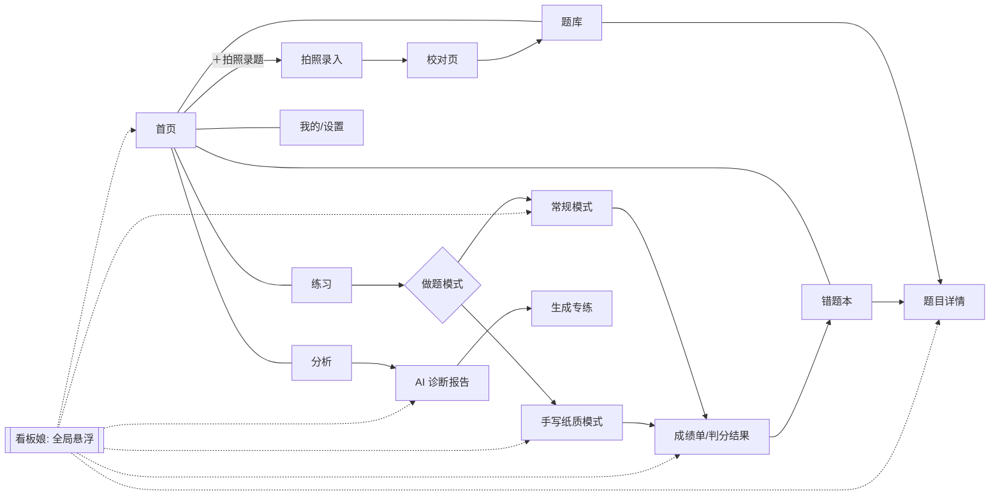

# InoU · 低保真线框图（手机 + 平板关键页面）

> 配套 [PRD](./01-需求文档-PRD.md) 与 [开发文档](./02-开发文档.md)。线框仅表达**信息架构与交互**，不含视觉稿。
> 符号：`[按钮]` `(•)`单选 `[✓]`复选 `▭`输入框 `░`占位/图片 `──`分隔线 `▸`可展开 `⋮`更多。
> 尺寸：手机 Compact（<600dp，竖屏为主）；平板 Expanded（≥840dp，横屏为主）。

---

## 0. 导航与页面地图



**底部导航（手机）/ 侧边栏（平板）**：首页 · 题库 · 练习 · 错题本 · 分析（"我的/设置"在头像入口或侧栏底部）。

---

## 1. 首次使用

### 1.1 手机
```
┌──────────────────────────┐
│                          │
│        ░░░░░░░░░         │
│       ░ 诺诺老师  ░       │   ← 看板娘立绘 happy
│        ░░░░░░░░░         │
│  ┌────────────────────┐  │
│  │ 同学你好呀～我是诺诺老师！│  │   ← 气泡
│  │ 先告诉我你的名字吧     │  │
│  └────────────────────┘  │
│  昵称  ▭ 小明             │
│  学段  (•)小学 ( )初中 ( )高中│
│  年级  [ 五年级        ▾] │
│  主修  [✓]语文 [✓]数学 [✓]英语│
│                          │
│        [ 下一步 ]         │
└──────────────────────────┘
步骤：①档案 → ②数据外发告知与同意（含监护人提示）→ ③配置 AI 服务（Gemini / OpenAI 兼容，可跳过）→ ④进入首页
```

### 1.2 数据外发告知 + AI 服务配置
```
┌──────────────────────────┐
│ 关于你的数据               │
│ • 题库、错题、笔迹只保存在  │
│   这台设备上               │
│ • 使用"拍照录题/AI 判分/   │
│   老师讲解/报告/出题"时，   │
│   相关图片或文字会发送到你  │
│   所配置的 AI 服务         │
│ • 建议在家长陪同下使用      │
│ [✓] 我和监护人已了解并同意  │
│                          │
│ 协议  (•)Gemini 原生      │
│       ( )OpenAI 兼容格式   │
│ 预设  [自定义/百炼/智谱… ▾]│
│ 地址  ▭ https://...       │   ← 选中 OpenAI 兼容或代理时展示
│ Key   ▭ sk-••••••••••     │
│ 模型  ▭ gpt-4o (识图多模态)│   ← 可展开"按档位分别指定"
│ [ 测试文本+识图 ] ✓ 可用   │
│ [ 稍后再说 ]   [ 完成 ]    │
└──────────────────────────┘
```

---

## 2. 首页

### 2.1 手机
```
┌──────────────────────────┐
│ 小明 ▾(切换档案)      ⚙  │
│ ┌──────────────────────┐ │
│ │ ░看板娘░  今天也要加油哦！│ │  ← 点击打开对话
│ │         [老师讲讲错题] │ │
│ └──────────────────────┘ │
│ 继续上次                   │
│ ┌──────────────────────┐ │
│ │ 数学期中卷 · 已做 12/20 │ │
│ │ [继续作答]             │ │
│ └──────────────────────┘ │
│ ┌────┐ ┌────┐ ┌────┐     │
│ │＋拍照│ │整卷 │ │错题 │     │
│ │录题 │ │模拟 │ │重做 │     │
│ └────┘ └────┘ └────┘     │
│ 待办                      │
│ • 待校对：语文单元卷(8题)   │
│ • AI 答案待核对：5 题       │
│ 薄弱点 TOP3（点击下钻）     │
│ ① 一元二次方程 ████▌ 62%   │
│ ② 完形填空   ███▌  48%    │
│ ③ 电学基础   ██▌   35%    │
├──────────────────────────┤
│ 首页 题库 练习 错题 分析   │
└──────────────────────────┘
```

### 2.2 平板（侧栏 + 双栏）
```
┌────────┬──────────────────────────────┬────────────────┐
│ ░logo  │ 小明 ▾                  ⚙   │  看板娘          │
│        │ ┌─────────┐┌──────────────┐  │   ░░░░░░        │
│ ▣ 首页 │ │ ＋拍照录题 ││ 继续：数学期中卷││  ░ 诺诺 ░       │
│ ☰ 题库 │ └─────────┘└──────────────┘  │   ░░░░░░        │
│ ✎ 练习 │ 快捷入口 [整卷][组卷][错题重做]│  ┌────────────┐ │
│ ✕ 错题 │ 薄弱点 TOP5     学科雷达图     │  │今天先复习     │ │
│ ◔ 分析 │ ① …████        ░░雷达░░     │  │"一元二次方程" │ │
│        │ ② …███                       │  │[开始专练]    │ │
│ 头像   │ 待办                          │  └────────────┘ │
└────────┴──────────────────────────────┴────────────────┘
```

---

## 3. 拍照录入

### 3.1 入口选择（底部弹层）
```
┌──────────────────────────┐
│  录入题目                  │
│ ┌──────────────────────┐ │
│ │ 📄 整卷/整页批量拍       │ │  多页，AI 切分多道题
│ ├──────────────────────┤ │
│ │ ✂ 单题快拍/框选         │ │  只录一道题（常用于错题）
│ ├──────────────────────┤ │
│ │ 🖼 从相册导入           │ │
│ ├──────────────────────┤ │
│ │ ✎ 手动新建题目           │ │
│ └──────────────────────┘ │
└──────────────────────────┘
```

### 3.2 取景与矫正（手机）
```
┌──────────────────────────┐
│ ✕                  闪光 ⚡ │
│ ┌──────────────────────┐ │
│ │░░░░░░░░░░░░░░░░░░░░░░│ │
│ │░   ┌─────────────┐  ░│ │ ← 自动识别纸张边缘（绿框）
│ │░   │  试卷        │  ░│ │
│ │░   └─────────────┘  ░│ │
│ └──────────────────────┘ │
│ 已拍 3 页  [▭][▭][▭]       │
│      ( ◉ 拍照 )   [完成]   │
└──────────────────────────┘
→ 完成后：页序调整/删除/旋转 → 四角微调（放大镜）→ 选择学科(可"自动判断") → [开始识别]
```

### 3.3 识别进度
```
┌──────────────────────────┐
│ 正在识别 · 数学期中卷       │
│ 预估：4 页 · 约 12 次 AI 调用 │
│ ├ 版面分析   ████████ 4/4  │
│ ├ 逐题识别   █████░░░ 14/22│
│ ├ 答案生成   ██░░░░░░  4/22│
│ └ 去重检查   ░░░░░░░░       │
│ 诺诺：马上好～先去喝口水吧 ░ │
│ [ 先去校对已完成的题 ]  [取消]│
└──────────────────────────┘
```

---

## 4. 校对页（核心）

### 4.1 平板（左原图 / 右编辑）
```
┌─────────────────────────────┬────────────────────────────────────────┐
│ ← 数学期中卷   第2页/4  ⋮     │ 题 5/22  [选择题▾]  AI 置信度 ●●●○  ⚠1处 │
│ ┌─────────────────────────┐ │ ┌────────────────────────────────────┐ │
│ │ ░░░░░░░░░░░░░░░░░░░░░░░ │ │ │ 题干                                 │ │
│ │ ░ ┌─[5]────────────┐   ░ │ │ │ 已知 [x²-5x+6=0]  ← 公式预览(LaTeX)   │ │
│ │ ░ │ 题区(高亮蓝框)   │   ░ │ │ │ 则 x 的值是（ ）                      │ │
│ │ ░ └────────────────┘   ░ │ │ ├────────────────────────────────────┤ │
│ │ ░ ┌─[6]─────┐          ░ │ │ │ 选项  ⠿A. 2或3   ⠿B. -2或-3  ⠿C.… ＋  │ │
│ │ ░ └─────────┘          ░ │ │ │ 答案  (•)A ( )B ( )C ( )D            │ │
│ │ ░░░░░░░░░░░░░░░░░░░░░░░ │ │ │      来源：[卷面答案] / AI·未核对 ⚠    │ │
│ └─────────────────────────┘ │ │ 解析 ▸                                │ │
│ [重新框选此题] [合并上题]     │ │ 知识点 [一元二次方程·因式分解法 ✎] ＋   │ │
│ 页缩略图 ▭▭▭▭                │ │ 难度 [普通▾]  标签 ＋                  │ │
│                             │ │ 卷面批改：✗ (老师红叉)                 │ │
│                             │ │ [✓]标记为错题  错因 [粗心][计算错▾]     │ │
│                             │ │ 疑似重复：与"期末卷 第3题"相似 [查看]    │ │
│                             │ └────────────────────────────────────┘ │
│                             │ [拆分] [删除] [重新识别]    [上一题][下一题]│
├─────────────────────────────┴────────────────────────────────────────┤
│ 已确认 12 / 22   待处理 3 (低置信度)    [ 全部确认入库 ]                 │
└──────────────────────────────────────────────────────────────────────┘
```

### 4.2 手机（上原图 / 下编辑，可拖拽分隔）
```
┌──────────────────────────┐
│ ← 校对 5/22         [确认]│
│ ┌──────────────────────┐ │
│ │ ░ 原图（题区蓝框）░    │ │ ← 点击全屏对照
│ └──────────────────────┘ │
│ ━━━━ 拖动调整比例 ━━━━     │
│ [选择题▾] 置信度●●●○ ⚠1    │
│ 题干 ▭ 已知 x²-5x+6=0 ...  │
│ 选项 ⠿A ⠿B ⠿C ⠿D  ＋      │
│ 答案 (•)A   [AI·未核对]    │
│ 知识点 因式分解法 ✎         │
│ [✓]标记为错题  错因 ▾       │
│ ⋮ 拆分/合并/删除/重新识别   │
│ [‹ 上一题]      [下一题 ›] │
└──────────────────────────┘
```

---

## 5. 题库

### 5.1 手机
```
┌──────────────────────────┐
│ 题库            ＋  🔍    │
│ [全部▾][数学▾][题型▾][知识点▾]│
│ 来源卷 │ 题目 │ 文件夹       │  ← 分段切换
│ ┌──────────────────────┐ │
│ │ 数学期中卷 · 22题 · 7年级 │ │
│ │ 错题 6 · 来源：拍照      │ │
│ └──────────────────────┘ │
│ ┌──────────────────────┐ │
│ │ AI 专练 · 一元二次方程   │ │
│ │ 10题 · AI生成           │ │
│ └──────────────────────┘ │
└──────────────────────────┘
```
### 5.2 平板（列表-详情）
```
┌────────┬──────────────────────────┬─────────────────────────────┐
│ 侧栏   │ 筛选栏  [数学][选择题][难度]│ 题目详情                      │
│        │ ─────────────────────── │ 题面（渲染）                   │
│        │ ○ Q5 已知 x²-5x… 选择 [错]│ ░░░░░░░░                      │
│        │ ○ Q6 如图，△ABC… 解答     │ 答案/解析 ▸（默认折叠）         │
│        │ ○ Q7 ……                  │ 来源：数学期中卷 第5题 [看原图]  │
│        │                          │ 做题历史 ✓✗✓                  │
│        │                          │ [加入错题本][练这道][老师讲讲]   │
└────────┴──────────────────────────┴─────────────────────────────┘
```

---

## 6. 练习入口与组卷

```
┌──────────────────────────┐
│ 开始练习                   │
│ ┌ 整卷模拟 ──────────────┐ │
│ │ 选来源卷：[数学期中卷 ▾] │ │
│ │ 计时 [✓] 60 分钟        │ │
│ │ 判分 (•)交卷后 ( )逐题   │ │
│ └────────────────────────┘ │
│ ┌ 自定义组卷 ─────────────┐ │
│ │ 学科[数学▾] 知识点[选择…] │ │
│ │ 题型[✓选择✓填空□解答…]   │ │
│ │ 难度[全部▾] 数量[10]     │ │
│ │ 策略 (•)随机 ( )优先未掌握│ │
│ └────────────────────────┘ │
│ ┌ 错题重做 ──────────────┐ │
│ │ 范围[未掌握▾] 数量[10]   │ │
│ │ 判分 (•)逐题即时 ( )交卷后│ │
│ └────────────────────────┘ │
│ 做题模式  (•)常规  ( )手写纸质│  ← 平板+触控笔时默认推荐手写
│            [ 开始 ]        │
└──────────────────────────┘
```

---

## 7. 常规数字化做题

### 7.1 手机：选择题
```
┌──────────────────────────┐
│ ← 3/20   ⏱ 12:30  [题号][⋮]│
│ ━━━━━━━○───────────────  │
│ 【选择题】 3分              │
│ 已知 x²-5x+6=0，则 x =（ ）│
│ ┌──────────────────────┐ │
│ │ A  2 或 3             │ │ ← 整行可点
│ └──────────────────────┘ │
│ ┌──────────────────────┐ │
│ │ B  -2 或 -3           │ │
│ └──────────────────────┘ │
│  …                       │
│ [⚑存疑] [草稿]    [老师提示]│  ← 分级提示按钮
│ [‹ 上一题]    [ 下一题 › ] │
│                   ░诺诺░  │  ← 可收起悬浮头像
└──────────────────────────┘
```
### 7.2 手机：填空 / 排序 / 连线 / 分类
```
填空(input)                 排序(sequence)              连线(connect)              分类(bins)
 I ▭___ to school.           [ I ][ can ][ swim ]         cat ●────────● 🐶pic       词池: [apple][cat][dog]
 [数学键盘: 分数 √ x² π …]    ↓ 拖入                         dog ●        ● 🐱pic       ┌水果┐ ┌动物┐
                              [__][__][__]                 bird ●       ● 🐦pic       │    │ │    │ ← 拖入
```
### 7.3 手机：解答题（分步输入）
```
┌──────────────────────────┐
│ 【解答题】 6分              │
│ 解方程 x²-5x+6=0 并写出过程│
│ 步骤1 ▭ x²-5x+6=(x-2)(x-3)│
│ 步骤2 ▭ x-2=0 或 x-3=0     │
│ 步骤3 ▭ x₁=2，x₂=3         │
│ ＋添加一步   [📷拍照上传解答] │
│ 数学键盘 ▸ ½ √ x² π ≤ ≥ ∠ │
│ [草稿]                [提交]│
└──────────────────────────┘
```
### 7.4 手机：组合题（阅读理解）
```
┌──────────────────────────┐
│ 【阅读理解】共 4 小题        │
│ ┌ 材料(可折叠/吸顶) ───▾───┐ │
│ │ ① The sun… ②…           │ │
│ └──────────────────────┘ │
│ ━━ 拖动调整材料/小题比例 ━━ │
│ 小题 [1][2][3][4] ← 切换    │
│ 1. What is the passage…?  │
│ (•)A … ( )B …              │
└──────────────────────────┘
```
### 7.5 平板：常规模式（双栏）
```
┌──────────┬────────────────────────────────────┬──────────────┐
│ 题号面板  │ 当前题（材料+作答）                   │ 看板娘/提示栏  │
│ ① ② ③ …  │                                    │   ░诺诺░      │
│ ✓✓●○○…   │                                    │ [给点思路]    │
│ ⚑存疑    │                                    │ [再提示一步]  │
└──────────┴────────────────────────────────────┴──────────────┘
```

---

## 8. 手写纸质模式（平板）

### 8.1 整体
```
┌──────────────────────────────────────────────────────────────────────┐
│ ← 数学期中卷  1/3页  ⏱ 45:12   [常规模式切换] [草稿区] [提交]  ⋮       │
├──┬───────────────────────────────────────────────────────────┬───────┤
│工│ ┌───────────── A4 纸 ─────────────┐                        │ 草稿区 │
│具│ │ 姓名：小明      日期：          │                        │┌─────┐│
│栏│ │       数学期中测试卷             │                        ││░░░░░││
│  │ │ 一、选择题（每题3分）            │                        ││░手写░││
│✎ │ │ 1. 已知 x²-5x+6=0，则 x=( B )   │ ← 括号内手写或点选      ││░░░░░││
│▭ │ │    A.2或3  ○B.-2或-3  ○C. …    │ ← 选项气泡可点选        │└─────┘│
│⌫ │ │ 二、填空题                       │                        │       │
│↶ │ │ 5. 计算：√8 ÷ √2 = ______(4)    │ ← 手写区在下划线上       │ 老师   │
│↷ │ │ 三、解答题                       │                        │ ░诺诺░ │
│◐ │ │ 12. 解方程并写出过程（6分）       │                        │[圈选   │
│  │ │ ┌──────────────────────────┐   │                        │ 求讲解]│
│  │ │ │ (作答区，可拖拽调整高度)     │   │  ← 笔迹叠加在题面上     │       │
│  │ │ │ x²-5x+6=0                │   │                        │       │
│  │ │ │ (x-2)(x-3)=0 …           │   │                        │       │
│  │ │ └─────────⇕────────────────┘   │                        │       │
│  │ └─────────────────────────────────┘                        │       │
├──┴───────────────────────────────────────────────────────────┴───────┤
│ 页 [1][2][3]    双指缩放/平移    笔：黑▾ 细▾   (检测到触控笔：已启用手掌拒触) │
└──────────────────────────────────────────────────────────────────────┘
工具栏：✎笔  ▭荧光笔(P1)  ⌫橡皮  ↶撤销  ↷重做  ◐套索(P1)
```

### 8.2 特殊题型的纸质组件
```
书写题(write)  拼音四线格 / 田字格          作图题(draw) 底图+坐标系          看图标注(spatial)
┌─┬─┬─┐ ┌─┬─┬─┐                          ┌───────────────┐                  ┌─────────────┐
│ │ │ │ │ │ │ │  默写：床前明月光…         │   y↑          │                  │ ░░题图░░ ①②  │
└─┴─┴─┘ └─┴─┴─┘                          │    ·→x  网格   │ ← 手写作图        │ 手写圈点/箭头  │
                                          └───────────────┘                  └─────────────┘
```

### 8.3 交卷与判分中
```
┌──────────────────────────┐
│ 正在批改…                  │
│ 客观题 ✓ 已完成 (本地)      │
│ 手写题 ████░░░ 5/8 (AI 判分)│
│ 诺诺：认真批改中～           │
│ [后台进行]                  │
└──────────────────────────┘
```

### 8.4 批改回看（红笔标注叠加）
```
┌──────────────────────────────────────────────────────────┐
│ 12. 解方程并写出过程（6分）                    得分 4/6  ✎改判 │
│ ┌──────────────────────────────────────────────────────┐ │
│ │ x²-5x+6=0                                    ✓ 列式正确 │ │
│ │ (x-2)(x-3)=0                                 ✓          │ │
│ │ x=2                              ✗ 漏了 x=3（-2分）      │ │
│ └──────────────────────────────────────────────────────┘ │
│ AI 识别文本 ▸（可修正后重判）                                │
│ 判定：( )对 ( )部分对 (•)错   [加入错题本]  [老师讲讲]         │
└──────────────────────────────────────────────────────────┘
```

---

## 9. 成绩单 / 判分结果

```
┌──────────────────────────┐
│ 成绩单 · 数学期中卷         │
│      86 / 100   用时 52:10 │
│ 正确率 82%   客观 ✓ 主观 AI │
│ 题号：①✓ ②✓ ③✗ ④✓ ⑤✗ …  │
│ ┌ 本次答错 4 题 ────────┐  │
│ │ [✓]③ [✓]⑤ [✓]⑪ [ ]⑭   │  │
│ │ [ 全部加入错题本 ]       │  │  ← 询问式（设置可改为自动）
│ └──────────────────────┘  │
│ ⚠ 2 题依据 AI 参考答案      │
│ 薄弱提示：一元二次方程失分最多│
│ [逐题回看] [老师讲讲] [再练错题]│
└──────────────────────────┘
```

---

## 10. 错题本

### 10.1 手机
```
┌──────────────────────────┐
│ 错题本            🔍  ⋮   │
│ [数学▾][知识点▾][错因▾][状态▾]│
│ 统计：共45  新错8 学习中20  │
│       复习中12  已掌握5     │
│ ┌──────────────────────┐ │
│ │ 已知 x²-5x+6=0 …       │ │
│ │ 因式分解法 · 计算错误     │ │
│ │ 错2次 · 学习中 ●○○       │ │  ← 掌握进度 连续答对/N
│ └──────────────────────┘ │
│ ┌──────────────────────┐ │
│ │ …                      │ │
│ └──────────────────────┘ │
│ [ 错题重做 ]               │
└──────────────────────────┘
```
### 10.2 错题详情
```
┌──────────────────────────┐
│ ← 错题详情                 │
│ 题面（渲染）                │
│ 我当时的答案：B  卷面：✗     │
│ 正确答案 ▸（AI·未核对 ⚠）   │
│ 解析 ▸                     │
│ 错因 [计算错误✓][粗心✓] ＋   │
│ 掌握：学习中  连续答对 1/3   │
│ 笔记 ▭ ……                  │
│ [老师讲讲] [变式题×3] [重做] │
└──────────────────────────┘
```

---

## 11. 分析与报告

### 11.1 本地统计看板
```
┌────────────────────────────────────────┐
│ 分析   范围[近30天▾] 学科[全部▾]  [生成AI报告]│
│ ┌ 学科雷达 ┐ ┌ 薄弱知识点 TOP ───────────┐ │
│ │ ░░雷达░░ │ │ 一元二次方程 ████▌ 62% (9) │ │ ← 点击下钻
│ └─────────┘ │ 完形填空   ███▌  48% (6)   │ │
│              └───────────────────────────┘ │
│ ┌ 错因分布(饼) ┐ ┌ 趋势(周) 折线 ───────────┐│
│ │ 计算错 40%… │ │ ░░░░░░░░░                 ││
│ └────────────┘ └──────────────────────────┘│
│ 知识点树（折叠/展开）：数学 ▸ 代数 ▸ 方程 ▸ …  │
│ ⚠ 数据较少仅供参考（样本<5）                  │
└────────────────────────────────────────┘
```
### 11.2 AI 诊断报告
```
┌──────────────────────────┐
│ ← 诊断报告 11-20   [对比上次]│
│ 总评：计算与审题是主要失分点…  │
│ 薄弱点                      │
│ ① 一元二次方程·因式分解法     │
│   原因：十字相乘符号易错      │
│   建议：先练 5 道基础…        │
│   [一键专练] [看错题(9)]      │
│ ② …                        │
│ 两周计划  周一 … 周二 …       │
│ 较上次：因式分解 ↑改善 12%    │
└──────────────────────────┘
```
### 11.3 生成专练
```
┌──────────────────────────┐
│ 薄弱点专练                  │
│ 知识点：因式分解法 [＋]       │
│ 题型  [✓选择][✓填空][✓解答]  │
│ 难度梯度 基础3 普通4 拓展3    │
│ 数量 [10]    预计 2 次调用    │
│        [ 生成 ]             │
│ 生成中 6/10 … 已通过自检 5   │
│ 完成 → [立即练习] [查看题目]  │
└──────────────────────────┘
```

---

## 12. 看板娘老师

### 12.1 手机：讲解对话（底部半屏）
```
┌──────────────────────────┐
│ （错题题面折叠显示）         │
│ ┌──────────────────────┐ │
│ │ ░诺诺·思考░              │ │
│ │ 我们先看看你是怎么想的～   │ │
│ │ 你把 x²-5x+6 分解成了…    │ │  ← 流式输出
│ │ 这一步没问题👍 问题在第 2 步│ │
│ └──────────────────────┘ │
│ 快捷：[换种方法讲][为什么不选B]│
│       [讲慢一点][出道类似的]  │
│ ▭ 问诺诺…       [📷] [发送]  │
└──────────────────────────┘
```
### 12.2 做题中分级提示
```
┌──────────────────────────┐
│ ░诺诺░ 想先试试看吗？        │
│ [💡给点思路]                 │
│  └→ 思路：先想想怎么把左边    │
│     变成两个因式的乘积…       │
│     [再提示一步]             │
│      └→ 关键步骤：…          │
│         [告诉我答案]         │
│ 已使用提示 2 次              │
└──────────────────────────┘
```
### 12.3 通用问答 / 临时拍照提问
```
全局悬浮头像 ░ → 长按：[问个问题][拍照问题][静音一小时]
```
### 12.4 平板手写：圈选求讲解
```
 在纸上用套索圈出一段 → 浮出 [问诺诺] → 诺诺侧栏气泡带圈选缩略图开始讲解
```

---

## 13. 设置 / 档案 / 备份

```
┌──────────────────────────┐
│ 设置                       │
│ 档案  小明 ▾  [新建][管理]   │
│ AI   当前：[OpenAI兼容·qwen-vl▾]│  ← 点击进入 AI 端点管理（多套配置切换）
│      Key/地址/分档模型 ▸  用量 ▸│
│      (含 JSON降级与坐标顺序高级项)│
│ 做题  默认模式[自动推荐▾]     │
│      错题收录 (•)询问 ( )自动 │
│      已掌握需连续答对 [3] 次  │
│ 看板娘 [✓]显示 [✓]动画 [ ]朗读│
│       语气[按学段自动▾]       │
│ 安全  家长锁 [开] 修改PIN    │
│ 数据  [导出备份包][导入备份]   │
│      存储占用 1.2GB [清理缓存]│
│ 关于/隐私说明/AI 数据外发说明  │
└──────────────────────────┘
```

---

## 14. 自适应对照表

| 页面 | Compact（手机） | Medium | Expanded（平板） |
|---|---|---|---|
| 导航 | 底部栏 | 侧轨(图标) | 展开侧栏 |
| 首页 | 单列卡片 | 两列 | 主区 + 看板娘侧栏 |
| 题库 | 列表 → 推入详情 | 列表+详情可选 | 筛选栏 + 列表 + 详情 |
| 校对页 | 上图下编辑（可拖拽） | 左右 4:6 | 左原图 / 右编辑 |
| 常规做题 | 一屏一题 | 题号面板可展开 | 三栏：题号/题目/看板娘 |
| 手写做题 | 可开启（提示推荐平板） | 纸张居中 | 纸张 + 左工具栏 + 右草稿/看板娘 |
| 错题本 | 列表 → 详情 | 双栏 | 筛选 + 列表 + 详情 + 统计 |
| 报告 | 单列滚动 | 双列 | 报告 + 图表并排 |
| 看板娘 | 底部半屏 / 悬浮头像 | 右侧抽屉 | 常驻侧栏 |
